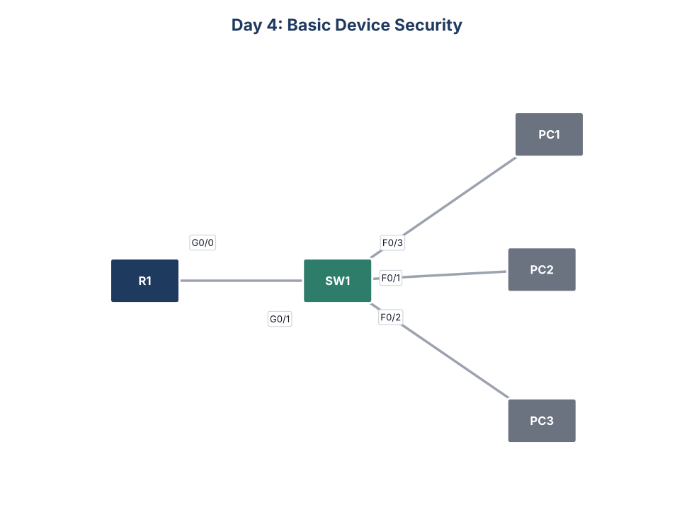

# Day 4: Basic Device Security



## Goal
Secure privileged EXEC access on a Cisco router and switch, and make sure no password shows in plain text in the configuration.

## What I configured
- Set the hostnames to R1 and SW1
- Set an enable password, tested it, and viewed it in the running configuration
- Turned on `service password-encryption` so current and future passwords are hidden
- Replaced the weak enable password with an `enable secret`, which stores a hashed password
- Saved the configuration on both devices

## Key commands
```
hostname R1
enable password <password>
service password-encryption
enable secret <password>
show running-config
copy running-config startup-config
```

## What I learned
`service password-encryption` only uses Type 7 encoding, which is easy to reverse. `enable secret` stores a Type 5 (MD5) hash, and when both are set, the device uses the secret.

## Files
- `configs/`: running configuration of each device
- `Day_04_Lab_-_Basic_Device_Security.pkt`: Cisco Packet Tracer file

Lab passwords are for practice only.
