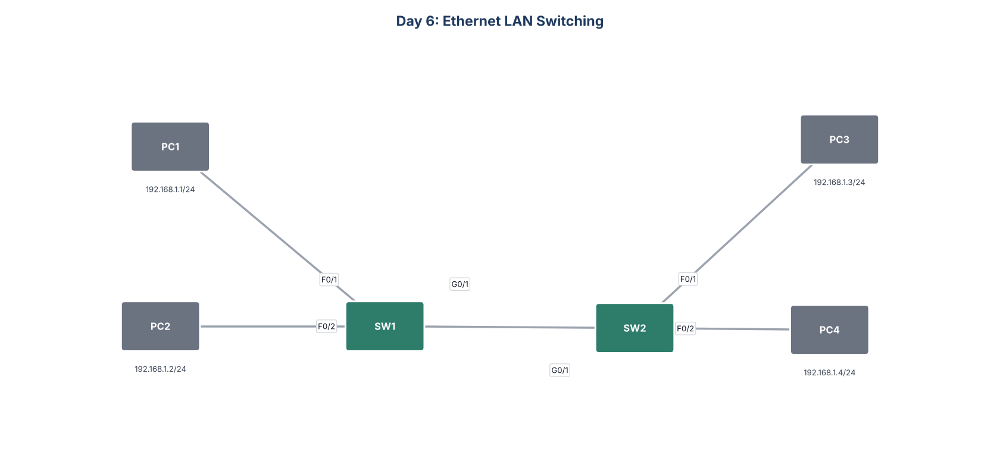

# Day 6: Ethernet LAN Switching



## Goal
Watch how switches learn MAC (Media Access Control) addresses and forward frames, and how ARP (Address Resolution Protocol) works on a LAN (Local Area Network).

## What I did
- Predicted which messages a ping from PC1 to PC3 would send and which devices would receive them
- Ran the ping in Packet Tracer simulation mode to check: the ARP request floods to every host, the ARP reply returns as unicast, then ICMP (Internet Control Message Protocol) echo traffic follows
- Generated traffic so both switches learned the MAC address of every PC
- Matched each PC to its MAC address and switch port with `show` commands
- Cleared the dynamic entries from each MAC address table

## Key commands
```
show mac address-table
show mac address-table dynamic
clear mac address-table dynamic
arp -a          (on the PCs)
```

## What I learned
A switch learns the source MAC of each frame on the port it arrives on. It floods frames with an unknown destination and forwards frames with a known destination out a single port.

## Files
- `configs/`: running configuration of each switch
- `Day_06_Lab_-_Ethernet_LAN_Switching.pkt`: Cisco Packet Tracer file
