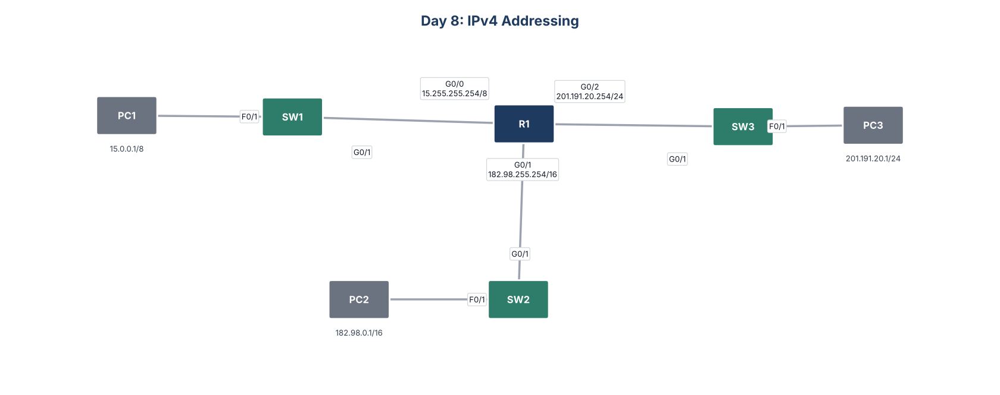

# Day 8: IPv4 Addressing



## Goal
Configure IPv4 addresses on a router that connects three networks: a Class A /8, a Class B /16, and a Class C /24.

## What I configured
- Set R1's hostname
- Gave each router interface the last usable address in its network and enabled it

| Interface | Network | Address |
|---|---|---|
| G0/0 (to SW1) | 15.0.0.0/8 | 15.255.255.254 |
| G0/1 (to SW2) | 182.98.0.0/16 | 182.98.255.254 |
| G0/2 (to SW3) | 201.191.20.0/24 | 201.191.20.254 |

- Added interface descriptions
- Configured PC1, PC2, and PC3 with IP addresses and default gateways
- Saved the configuration and confirmed reachability with pings between all three PCs

## Key commands
```
show ip interface brief
interface g0/0
 description ## to SW1 ##
 ip address 15.255.255.254 255.0.0.0
 no shutdown
copy running-config startup-config
```

## Files
- `configs/`: running configuration of each device
- `Day_08_Lab_-_IPv4_Addresses.pkt`: Cisco Packet Tracer file
