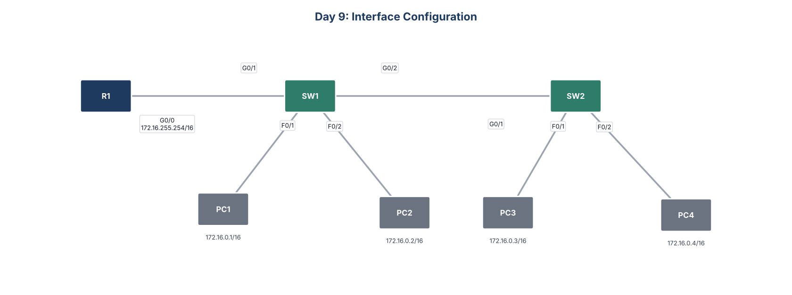

# Day 9: Interface Configuration



## Goal
Configure router and switch interfaces the way you would on a production network: addressed, labeled, tuned, and locked down.

## What I configured
- Set hostnames on R1, SW1, and SW2
- Addressed R1 and all four PCs in 172.16.0.0/16
- Set speed to 1000 and duplex to full on every link between network devices, and left end host ports on auto
- Added a description to every interface, including "not in use" on spare ports
- Shut down every unused interface so nothing can plug into an open port
- Saved the configurations

## Key commands
```
interface range f0/3 - 24
 description ## not in use ##
 shutdown
interface g0/1
 description ## to R1 ##
 speed 1000
 duplex full
show interfaces status
```

## Files
- `configs/`: running configuration of each device
- `Day_09_Lab_-_Interface_Configuration.pkt`: Cisco Packet Tracer file
