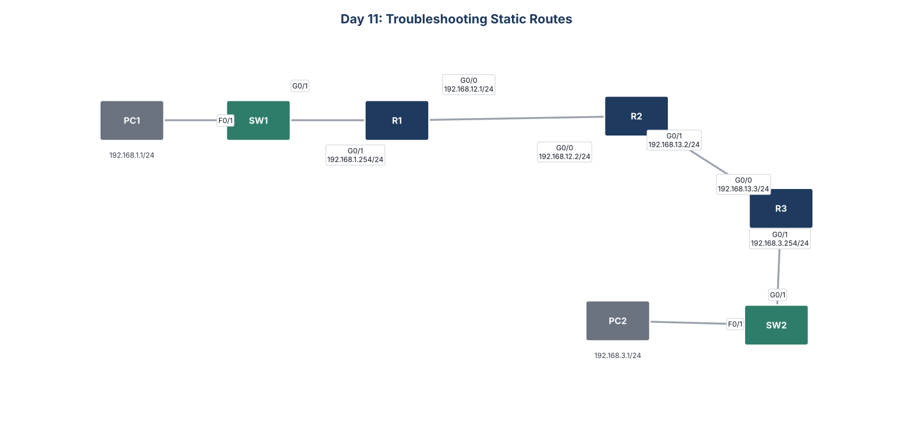

# Day 11: Troubleshooting Static Routes



## Goal
PC1 and PC2 could not ping each other. Each of the three routers had one misconfiguration. Find and fix all three.

## What I found and fixed

| Router | Problem | Fix |
|---|---|---|
| R1 | Route to 192.168.3.0/24 pointed to 192.168.12.3, which does not exist | Pointed the route to R2 at 192.168.12.2 |
| R2 | Route to 192.168.3.0/24 sent traffic out G0/0, back toward R1 | Pointed the route to R3 at 192.168.13.3 |
| R3 | G0/0 had 192.168.23.3, the wrong subnet for the R2 to R3 link | Readdressed G0/0 to 192.168.13.3/24 |

After the fixes, PC1 and PC2 ping each other in both directions.

## How I troubleshot
1. Checked each router's interfaces with `show ip interface brief`
2. Compared each route's next hop with the neighbor's real address using `show ip route`
3. Followed the path hop by hop, in both directions, since a reply needs its own route back

## Key commands
```
show ip interface brief
show ip route
no ip route 192.168.3.0 255.255.255.0
ip route 192.168.3.0 255.255.255.0 192.168.13.3
ping 192.168.3.1
```

## Files
- `configs/`: fixed running configuration of each device
- `Day_11_Lab_-_Troubleshooting_Static_Routes.pkt`: Cisco Packet Tracer file
