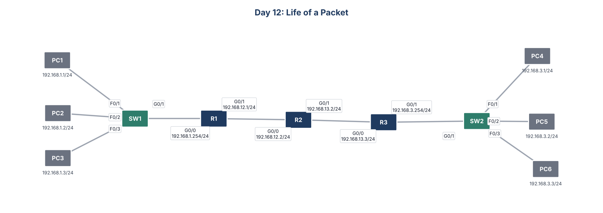

# Day 12: Life of a Packet



## Goal
Trace a packet across three routed hops and identify the source and destination MAC (Media Access Control) address on every segment.

## What I did
- Pinged once to complete ARP (Address Resolution Protocol) and MAC learning, then switched to simulation mode
- Traced PC1 to PC4 across six segments (PC1, SW1, R1, R2, R3, SW2, PC4) and recorded the MAC addresses at each one
- Traced PC1 to PC3 inside one LAN (Local Area Network) and compared the result
- Traced the return path from PC4 to PC1

## What I learned
The IP addresses stay the same from end to end. The MAC addresses change at every router hop, because each router builds a new Ethernet frame for the next segment. Inside a single LAN, the frame goes host to host with no router involved.

## Key commands
```
show ip route
show arp
show mac address-table
arp -a          (on the PCs)
```

## Files
- `configs/`: running configuration of each device
- `Day_12_Lab_-_Life_of_a_Packet.pkt`: Cisco Packet Tracer file
