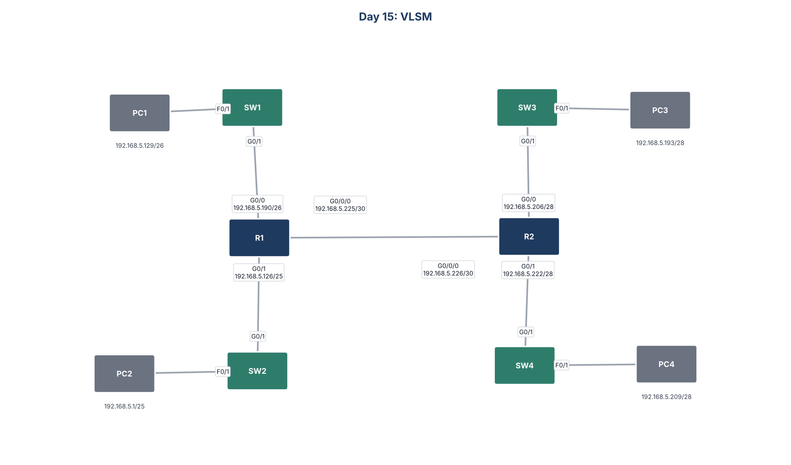

# Day 15: VLSM



## Goal
Split 192.168.5.0/24 with VLSM (Variable Length Subnet Masking) to fit four LANs of different sizes plus the link between the routers. Then configure static routes so every PC can reach every other PC.

## Subnet plan
I gave the largest LAN its subnet first, then worked down. Each PC uses the first usable address and each router interface uses the last.

| Network | Hosts needed | Subnet | Usable range | PC | Router |
|---|---|---|---|---|---|
| LAN2 | 64 | 192.168.5.0/25 | .1 to .126 | .1 | .126 |
| LAN1 | 45 | 192.168.5.128/26 | .129 to .190 | .129 | .190 |
| LAN3 | 14 | 192.168.5.192/28 | .193 to .206 | .193 | .206 |
| LAN4 | 9 | 192.168.5.208/28 | .209 to .222 | .209 | .222 |
| R1 to R2 | 2 | 192.168.5.224/30 | .225 to .226 | | R1 .225, R2 .226 |

That leaves 192.168.5.228 to 192.168.5.255 free for growth.

## Static routes
```
R1: ip route 192.168.5.192 255.255.255.240 192.168.5.226
R1: ip route 192.168.5.208 255.255.255.240 192.168.5.226
R2: ip route 192.168.5.0 255.255.255.128 192.168.5.225
R2: ip route 192.168.5.128 255.255.255.192 192.168.5.225
```

All four PCs ping each other successfully.

## Files
- `configs/`: running configuration of each device
- `Day_15_Lab_-_VLSM.pkt`: Cisco Packet Tracer file
