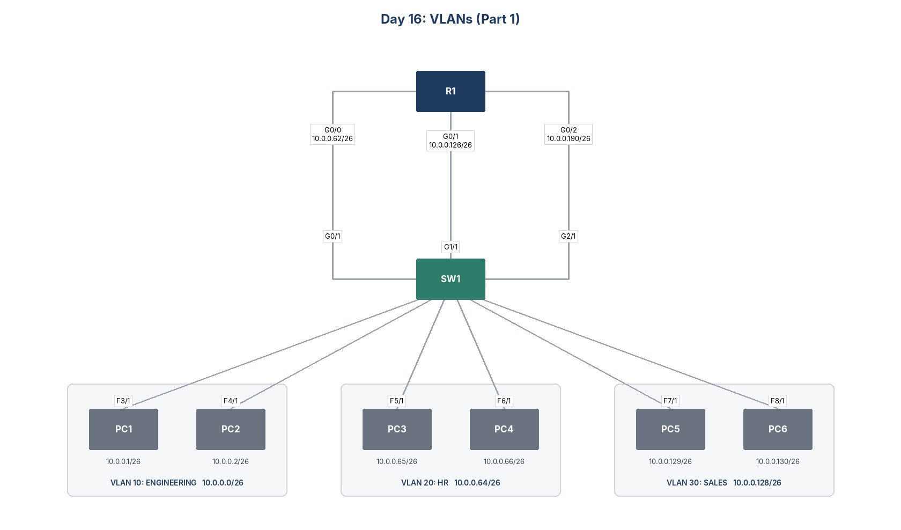

# Day 16: VLANs (Part 1)



## Goal
Split one switch into three VLANs (Virtual Local Area Networks) so each department gets its own broadcast domain. Then give R1 one interface in each VLAN so it can route traffic between them.

## VLAN plan
I divided 10.0.0.0/24 into four /26 subnets and used the first three. Each PC uses a low address and R1 uses the last usable address as the default gateway.

| VLAN | Name | Subnet | PCs | Switch ports | R1 gateway |
|---|---|---|---|---|---|
| 10 | ENGINEERING | 10.0.0.0/26 | PC1 .1, PC2 .2 | F3/1, F4/1, G0/1 | G0/0 10.0.0.62 |
| 20 | HR | 10.0.0.64/26 | PC3 .65, PC4 .66 | F5/1, F6/1, G1/1 | G0/1 10.0.0.126 |
| 30 | SALES | 10.0.0.128/26 | PC5 .129, PC6 .130 | F7/1, F8/1, G2/1 | G0/2 10.0.0.190 |

## Switch configuration
I created and named each VLAN, then set every port as an access port in its VLAN.
```
SW1(config)# vlan 10
SW1(config-vlan)# name ENGINEERING
SW1(config)# interface range f3/1, f4/1, g0/1
SW1(config-if-range)# switchport mode access
SW1(config-if-range)# switchport access vlan 10
```
I repeated the same steps for VLAN 20 (HR) and VLAN 30 (SALES).

## Inter VLAN routing
R1 has one physical link into each VLAN. Each router interface sits in a different subnet, so R1 routes between the VLANs with only connected routes. This design needs one router port per VLAN, which does not scale. Part 2 replaces it with a trunk and a router on a stick.

## Files
- `configs/`: running configuration of each device
- `Day_16_Lab_-_VLANs_(Part_1).pkt`: Cisco Packet Tracer file
